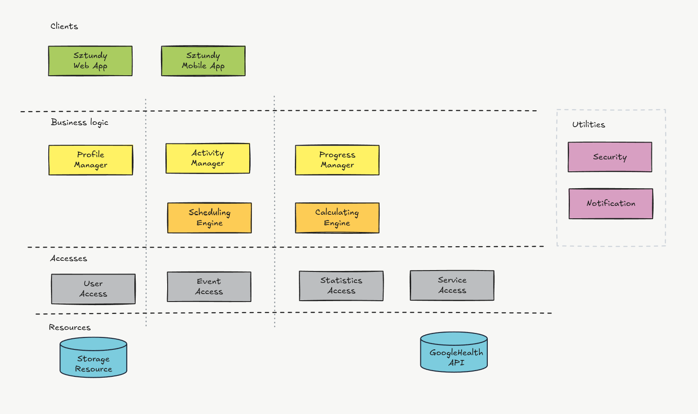
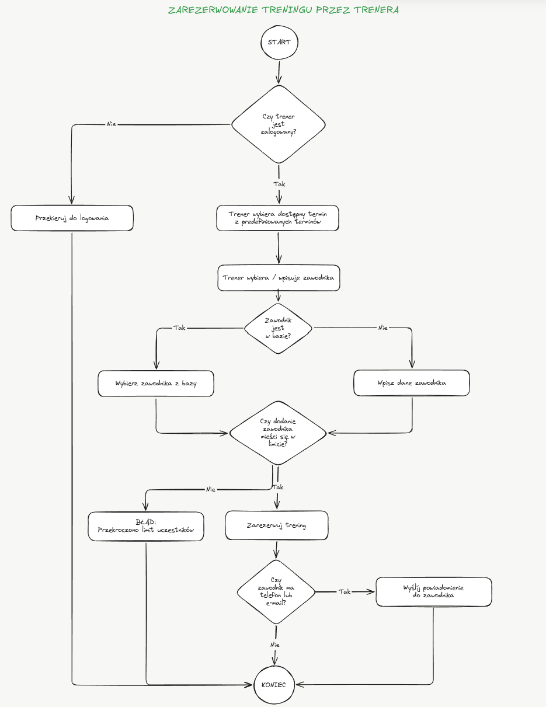
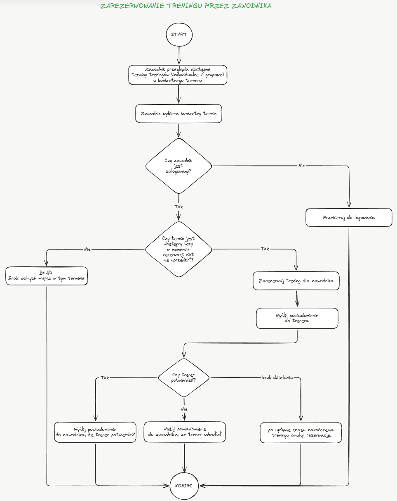

# sztundy

## Główne przypadki użycia:

1. Zarządzanie wydarzeniem sportowym (treningiem, sparingiem, obozem itp.)

Obejmuje:

- zarządzanie treningiem — umówienie/zmiana/odwołanie przez trenera/zawodnika
- zarządzanie sparingiem — umówienie/zmiana/odwołanie przez zawodnika
- zarządzanie dostępnością trenera
- zarządzanie dostępnością zawodnika
- wyszukiwanie wydarzenia sportowego
- dodawanie notatek do wydarzenia sportowego
- dodawanie oceny wydarzenia sportowego
- dodawanie/sugerowanie przez AI ćwiczeń do wydarzenia sportowego
- przeglądanie historii wydarzeń sportowych

2. Śledzenie i analiza statystyk, postępów oraz osiągnięć zawodnika

Obejmuje:

- przeglądanie statystyk — prezentacja danych, wykresy, wybór zakresów czasowych itd.
- pobieranie danych z różnych źródeł
- przetwarzanie/ujednolicanie danych
- wyliczanie statystyk, postępu, osiągnięć

## Pozostałe przypadki użycia:

1. zarządzanie profilem: informacje kontaktowe/sprzęt
2. zarządzanie użytkownikami (administrator aplikacji)
3. logowanie
4. płatności

## Obszary zmienności:

| #  | Obszar zmienności                           | Przykładowa zmienność                             |
|----|---------------------------------------------|---------------------------------------------------|
| 1  | **Typ i reguły wydarzenia**                 | trening, sparing, kolejne rodzaje aktywności      |
| 2  | **Workflow wydarzenia**                     | kto inicjuje, kolejność kroków, zmiana, odwołanie |
| 3  | **Dostępność uczestników**                  | dostępność trenera i zawodnika                    |
| 4  | **Reguły uczestnictwa**                     | indywidualne/grupowe, limity uczestników          |
| 5  | **Reguły planowania terminu**               | kolizje, luki, dopasowanie czasu, kompaktowość    |
| 6  | **Źródła danych aktywności**                | ręczne dane, urządzenia, zewnętrzne API           |
| 7  | **Transformacja danych**                    | mapowanie i ujednolicanie danych z różnych źródeł |
| 8  | **Reguły statystyk i postępu**              | sposób obliczania i agregowania danych            |
| 9  | **Klient / prezentacja**                    | trener, zawodnik, różne urządzenia i interfejsy   |
| 10 | **Powiadomienia**                           | odbiorcy, kanały, moment i sposób wysyłania       |
| 11 | **Security**                                | autentykacja, autoryzacja, credentials, sesje     |
| 12 | **Model i kontekst informacji dodatkowych** | notatki zawodnika, przeciwnika, aktywności itd.   |

## Statyczna architektura

